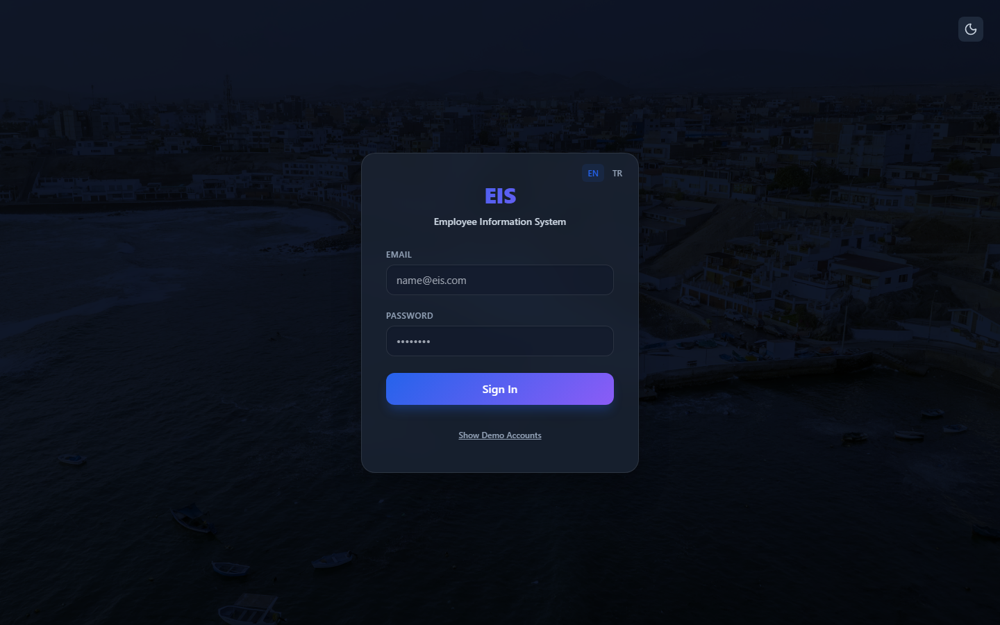

# EIS – Employee Information System

A leave management system I built during my 2026 internship at a Turkish company. An employee requests leave, their manager approves or rejects it, and HR gives the final sign-off. Leave types and durations follow the Turkish Labor Law (4857 Sayılı İş Kanunu). The interface is in Turkish and English and has a dark theme.

The front end is published at https://bovery-max.github.io/EIS-Employee-Information-System/. Signing in needs the API and a PostgreSQL database, so to try the whole flow run it locally as described below.



## What it does

- Four roles, each with its own dashboard and menu: Admin, HR, Manager and Employee.
- Two-step approval. A request goes `pending_manager` → `pending_hr` → `approved`; either step can reject it with a reason.
- Leave balances with year-end carry-over, and document upload only where the leave type needs it.
- Notifications for employees and approvers.
- For Admin: organization tree, user management, leave type configuration and an audit log of every action.

### Leave types

| Leave type | Duration | Weekends | Document |
|---|---|---|---|
| Annual (Yıllık İzin) | Min. 14 days per year | Excluded | – |
| Paternity (Babalık İzni) | 5 working days | Excluded | Birth certificate |
| Sick (Hastalık İzni) | Per medical report | Included | Medical report |
| Marriage (Evlilik İzni) | 3 working days | Excluded | Marriage certificate |
| Bereavement, 1st degree | 3 working days | Excluded | – |
| Bereavement, 2nd degree | 2 working days | Excluded | – |

## Running locally

You need Node.js 18 or newer and PostgreSQL.

```bash
git clone https://github.com/Bovery-Max/EIS-Employee-Information-System.git
cd EIS-Employee-Information-System
npm install
```

Create `apps/api/.env` from `apps/api/.env.example` (database URL and JWT secret), then:

```bash
npm run db:push      # creates the tables with Prisma
npm run api:dev      # API on port 4000
```

In a second terminal:

```bash
cd apps/web
npm run dev          # http://localhost:3000
```

### Demo accounts

Seed accounts for local development. The sign-in page also lists them under "Show Demo Accounts".

| Email | Password | Role |
|---|---|---|
| admin@eis.com | admin123 | Admin |
| hr@eis.com | hr123 | HR |
| manager@eis.com | manager123 | Manager |
| employee@eis.com | emp123 | Employee |

## Project structure

```
apps/web        Next.js app (App Router): login, dashboard, leave, manager, hr, admin, notifications
apps/api        Express API: authentication, leave requests, approvals
packages/db     Prisma schema and shared client
docs            specs and plans
```

## Stack

Next.js, React and TypeScript with Tailwind CSS on the front end. Express with Prisma on PostgreSQL behind it; JWT in an HTTP-only cookie, bcrypt for passwords. Tests with Jest and Supertest.
