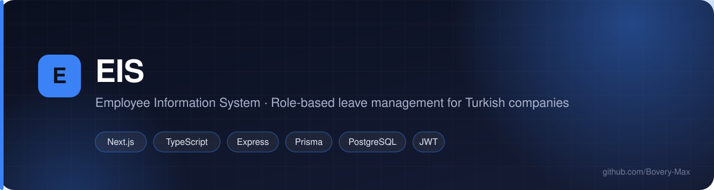
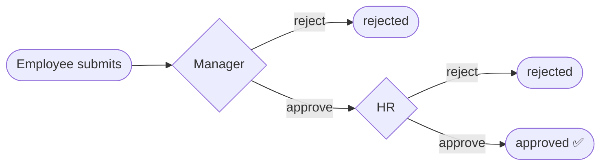

<div align="center">



<br/><br/>

<p><b>Role-based leave management for Turkish companies — built during my 2026 internship.</b></p>


<br/><br/>

<a href="https://bovery-max.github.io/EIS-Employee-Information-System/"></a>

<p>
<a href="#-features">Features</a> ·
<a href="#-approval-workflow">Workflow</a> ·
<a href="#-getting-started">Getting started</a> ·
<a href="#-demo-accounts">Demo accounts</a> ·
<a href="#-project-structure">Structure</a> ·
<a href="#-tech-stack">Tech stack</a>
</p>

</div>


## 📋 Overview

EIS carries a leave request through its whole life: an employee submits it, their manager approves or rejects it, and HR gives the final sign-off. Leave types, durations and required documents follow Turkish Labor Law (*4857 Sayılı İş Kanunu*). The interface is available in **Turkish and English**, in **dark and light** themes.

> The GitHub Pages build is the static front end. Signing in and the approval workflow need the API and a PostgreSQL database running locally — see [Getting started](#-getting-started).

## ✨ Features

<table>
  <tr>
    <td align="center" width="33%"><h3>🔐</h3><b>Four roles</b><br/><sub>Admin · HR · Manager · Employee, each with its own dashboard and sidebar</sub></td>
    <td align="center" width="33%"><h3>📅</h3><b>Law-compliant leave types</b><br/><sub>Six types with the durations, weekend rules and documents the law requires</sub></td>
    <td align="center" width="33%"><h3>🔄</h3><b>Two-step approval</b><br/><sub>Manager first, HR second, with rejection reasons and notifications</sub></td>
  </tr>
  <tr>
    <td align="center"><h3>🧾</h3><b>Audit log</b><br/><sub>Every action recorded and filterable by Admin</sub></td>
    <td align="center"><h3>🌳</h3><b>Organization tree</b><br/><sub>Company hierarchy managed from one screen</sub></td>
    <td align="center"><h3>📎</h3><b>Balances &amp; documents</b><br/><sub>Year-end carry-over and conditional document upload</sub></td>
  </tr>
</table>

### Roles

| Role | Can do |
|---|---|
| **Admin** | Everything below, plus organization tree, user management, leave-type configuration and audit logs |
| **HR** | Employee management and the HR approval queue |
| **Manager** | Team approval queue; approve or reject with a reason |
| **Employee** | Submit requests, see own history and balance |

### Leave types

| Leave type | Duration | Weekends | Document |
|---|---|---|---|
| Annual — *Yıllık İzin* | Min. 14 days / year | Excluded | — |
| Paternity — *Babalık İzni* | 5 working days | Excluded | Birth certificate |
| Sick — *Hastalık İzni* | Per medical report | Included | Medical report |
| Marriage — *Evlilik İzni* | 3 working days | Excluded | Marriage certificate |
| Bereavement, 1st degree | 3 working days | Excluded | — |
| Bereavement, 2nd degree | 2 working days | Excluded | — |

## 🔄 Approval workflow



Request states: `pending_manager` → `pending_hr` → `approved`, or `rejected` at either step.

## 🚀 Getting started

**Requirements:** Node.js 18+, PostgreSQL.

```bash
git clone https://github.com/Bovery-Max/EIS-Employee-Information-System.git
cd EIS-Employee-Information-System
npm install                                # installs every workspace
```

**1 · Database**

```bash
cp apps/api/.env.example apps/api/.env     # set DATABASE_URL and JWT_SECRET
npm run db:push                            # pushes the Prisma schema
```

**2 · API** — listens on port `4000`

```bash
npm run api:dev
```

**3 · Web** — in a second terminal

```bash
cd apps/web
npm run dev                                # http://localhost:3000
```

## 👥 Demo accounts

Seed values for local development only. The sign-in screen also lists them under *Show Demo Accounts*.

| Email | Password | Role |
|---|---|---|
| `admin@eis.com` | `admin123` | Admin |
| `hr@eis.com` | `hr123` | HR |
| `manager@eis.com` | `manager123` | Manager |
| `employee@eis.com` | `emp123` | Employee |

## 🗂️ Project structure

npm-workspaces monorepo.

```
apps/
  web/                       Next.js (App Router)
    app/
      login/
      dashboard/             role-based landing page
      leave/new/             new request form
      leave/history/
      manager/approvals/
      hr/approvals/
      hr/employees/
      admin/organization/
      admin/users/
      admin/leave-types/
      admin/audit-logs/
      notifications/
    components/              Sidebar and shared UI
    context/                 LanguageContext (TR / EN)
    lib/translations.ts
  api/
    index.js                 Express API: auth, leave requests, approvals
    .env.example
packages/
  db/
    prisma/schema.prisma
    src/client.ts            shared Prisma client
docs/                        specs, plans, README images
```

## 🛠️ Tech stack

| Layer | Technology |
|---|---|
| Frontend | Next.js (App Router), React, TypeScript, Tailwind CSS, next-themes |
| Backend | Node.js, Express, helmet, cors |
| Database | PostgreSQL via Prisma |
| Auth | JWT in an HTTP-only cookie, bcrypt password hashing |
| Tests | Jest + Supertest |

### Design tokens

| Color | Hex | Usage |
|---|---|---|
| 🔵 Blue | `#2563eb` | Primary actions, pending states |
| 🟢 Green | `#16a34a` | Approvals, success |
| 🔴 Red | `#dc2626` | Rejections, errors |
| ⬛ Dark navy | `#1e3a5f` | Sidebar |
| ⬜ Light gray | `#f9fafb` | Page background |

---

<div align="center">
<sub>Built during internship · 2026 · <a href="https://github.com/Bovery-Max">Emir Sanal</a> · <a href="https://www.linkedin.com/in/emir-sanal-12432b322/">LinkedIn</a></sub>
</div>
